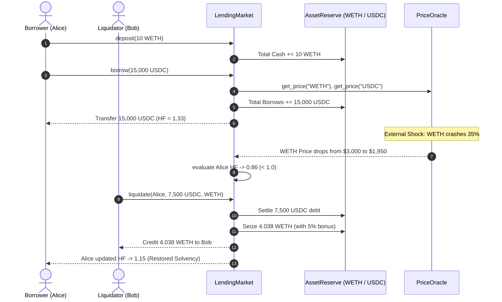

# AethelLend

[](https://github.com/ZengLLQ/aethel-lend/actions)
[](https://www.python.org/downloads/)
[](https://opensource.org/licenses/MIT)

**AethelLend** is a high-performance decentralized money market and over-collateralized lending protocol implemented in pure Python. It features dynamic piecewise-linear (kinked) interest rate curves, normalized share-based compounding indices, multi-collateral solvency verification, and partial liquidation auctions with close factors and collateral liquidation bonuses.

---

## Key Protocol Mechanisms

### 1. Kinked Interest Rate Curve
Capital utilization $U$ measures the ratio of borrowed capital relative to total pool liquidity:

$$
U = \frac{B}{C + B}
$$

Where $B$ is total borrowed principal, and $C$ is total unborrowed cash.

The instantaneous borrow interest rate $R_{\text{borrow}}(U)$ is modeled via a piecewise linear curve split at the optimal utilization threshold $U_{\text{opt}}$:

$$
R_{\text{borrow}}(U) =
\begin{cases}
R_0 + \left(\frac{U}{U_{\text{opt}}}\right) R_1, & \text{if } U \le U_{\text{opt}} \\
R_0 + R_1 + \left(\frac{U - U_{\text{opt}}}{1 - U_{\text{opt}}}\right) R_2, & \text{if } U > U_{\text{opt}}
\end{cases}
$$

Where:
- $R_0$ is the base interest rate at zero utilization.
- $R_1$ is the target slope up to $U_{\text{opt}}$.
- $R_2$ is the steep jump multiplier penalizing utilization beyond $U_{\text{opt}}$ to protect protocol liquidity.

The corresponding lending yield rate $R_{\text{supply}}(U)$ received by depositors is:

$$
R_{\text{supply}}(U) = U \cdot R_{\text{borrow}}(U) \cdot (1 - \gamma)
$$

Where $\gamma$ is the protocol reserve factor retained by the protocol treasury.

---

### 2. Multi-Collateral Solvency & Health Factor
An account's solvency is governed by its **Health Factor** $HF$. A position is strictly solvent when $HF \ge 1.0$:

$$
HF = \frac{\sum_{i \in \text{Collateral}} C_i \cdot P_i \cdot LT_i}{\sum_{j \in \text{Borrows}} B_j \cdot P_j}
$$

Where:
- $C_i$ is the user's deposit balance in collateral asset $i$.
- $P_i$ is the USD price reported by the decentralized price feed oracle.
- $LT_i$ is the asset's Liquidation Threshold ($0 < LT_i \le 1.0$).
- $B_j$ is the user's outstanding debt in borrowed asset $j$.

If $HF < 1.0$, the account enters the liquidation zone and third-party liquidators are incentivized to repay a fraction of the debt in exchange for discounted collateral.

---

### 3. Partial Liquidation Mechanics
To prevent market manipulation and cascading insolvency, liquidations enforce a maximum close factor $\beta = 50\%$:

$$
B_{\text{repay}} \le \beta \cdot B_{\text{borrower}}
$$

The amount of collateral seized $C_{\text{seized}}$ includes a liquidation bonus penalty $\delta$ (e.g. 5% to 10%):

$$
C_{\text{seized}} = \frac{B_{\text{repay}} \cdot P_{\text{debt}}}{P_{\text{collateral}}} \cdot (1 + \delta)
$$

---

## Architectural Protocol Flow



---

## Installation

```bash
# Clone the repository
git clone https://github.com/ZengLLQ/aethel-lend.git
cd aethel-lend

# Install with development dependencies
pip install -e .
```

---

## CLI Usage

### Simulate Market Crash & Liquidation
```bash
aethellend simulate --weth-deposit 10.0 --usdc-borrow 18000.0 --price-drop 0.35
```

### Run High-Throughput Performance Benchmark
```bash
aethellend benchmark --iterations 10000
```

---

## Python API Quickstart

```python
from aethellend import LendingMarket, ReserveConfig, PriceOracle

# 1. Setup Oracle & Market
oracle = PriceOracle()
oracle.set_price("USDC", 1.0)
oracle.set_price("WETH", 3000.0)

market = LendingMarket(oracle=oracle)
market.add_reserve(ReserveConfig(asset="USDC", loan_to_value=0.85, liquidation_threshold=0.90))
market.add_reserve(ReserveConfig(asset="WETH", loan_to_value=0.75, liquidation_threshold=0.80, liquidation_bonus=0.05))

# 2. Deposit Collateral & Borrow
market.deposit("alice", "WETH", 5.0)       # $15,000 Collateral
market.borrow("alice", "USDC", 8000.0)     # $8,000 Debt

collateral, debt, hf = market.get_account_liquidity("alice")
print(f"Alice Health Factor: {hf:.2f}")     # HF = 1.50
```

---

## Test Suite

Run the full pytest suite:

```bash
pytest -v
```

---

## License

This project is licensed under the MIT License - see the [LICENSE](LICENSE) file for details.
